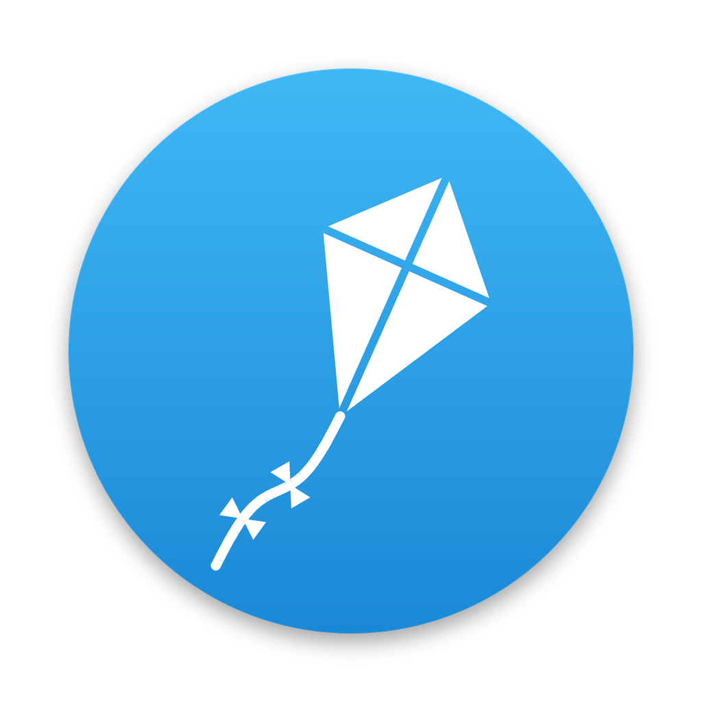
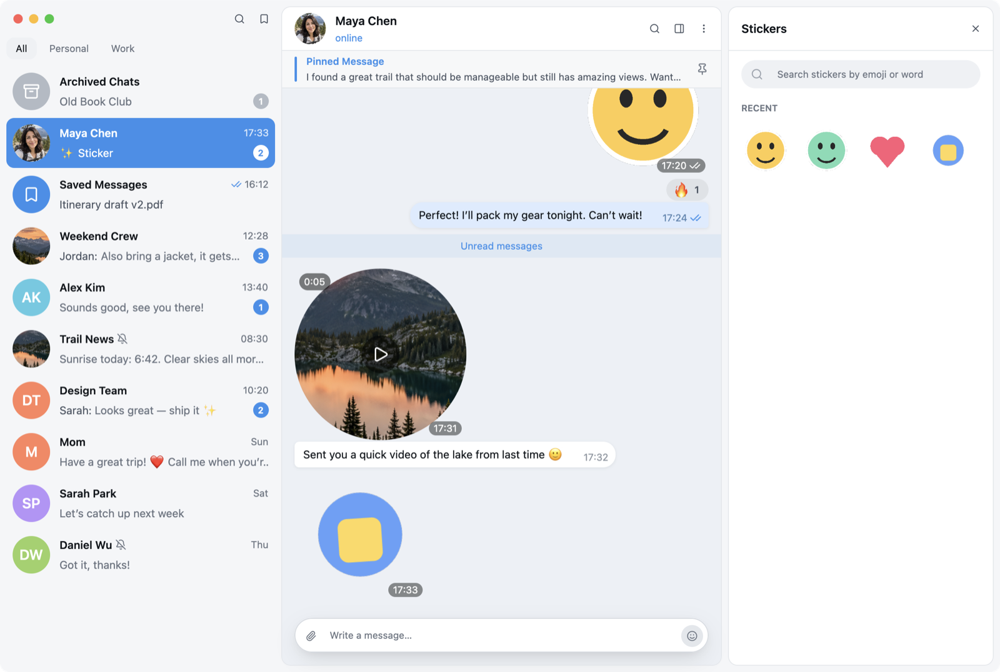

<p align="center">
  
</p>

<h3 align="center">Kite</h3>

<p align="center">A fast, native Telegram client for macOS, written in Rust with <a href="https://www.gpui.rs">GPUI</a> and <a href="https://core.telegram.org/tdlib">TDLib</a>.</p>

<picture>
  <source media="(prefers-color-scheme: dark)" srcset="assets/screenshots/dark.png">
  
</picture>

<sub>Screenshots use the built-in demo data, not a real account.</sub>

## Features

- **Chats**: folders, archive, pins, Saved Messages, and <kbd>⌘K</kbd> to jump to any chat or action
- **Messages**: replies, edits, forwards, reactions, polls, pinned messages, an unread divider and in-chat search
- **Formatting**: Telegram markdown or shortcuts (<kbd>⌘B</kbd>, <kbd>⌘I</kbd>, <kbd>⇧⌘M</kbd> and more); right-click the message field for the full list
- **Media**: a photo viewer, profile photo history, voice and round video playback, and animated stickers with a sticker panel
- **macOS**: follows light and dark mode; closing the window (<kbd>⌘W</kbd>) keeps Kite running in the menu bar

Not included: calls, voice recording, stories, secret chats, group administration.

## Run

You need Rust (stable) and Apple's Command Line Tools. TDLib is downloaded and linked automatically on the first build. Playing voice notes needs ffmpeg (`brew install ffmpeg`).

```sh
cargo run --locked            # development build
sh scripts/bundle.sh          # release app: target/Kite.app
```

`scripts/dev.sh` rebuilds and relaunches the app whenever a file in `src/` changes.

## Sign in

1. Create an app at [my.telegram.org](https://my.telegram.org) → **API development tools**.
2. Enter its API ID and hash in Kite.
3. Log in with a QR code (Telegram on your phone → Settings → Devices → Link Desktop Device) or with your phone number.

Your session lives in `~/Library/Application Support/Kite` (owner-only access). Treat it like a password.

## Demo mode

```sh
TG_DEMO=1 cargo run
```

Runs the full interface on seed data, without connecting to Telegram or touching your session. This is handy for design work and screenshots. Options:

- `TG_DEMO_THEME=light|dark` forces an appearance.
- `TG_DEMO_SCENE` opens a specific screen: `chat`, `group`, `channel`, `details`, `palette`, `search`, `viewer`, `avatar`, `reactions`, `compose`, `archive`, `login`.

## Project

| Path | What |
| --- | --- |
| `src/shell/` | The interface: sidebar, conversation, panels, menus |
| `src/telegram.rs` | TDLib client and requests |
| `src/ui.rs` | Design tokens: colors (dark and light), type, spacing, radii |
| `src/demo.rs` | Seed data for demo mode |
| `scripts/make_icon.py` | Draws the app, logo and menu bar icons |

Before committing:

```sh
cargo fmt --all && cargo clippy --all-targets --locked -- -D warnings
```
